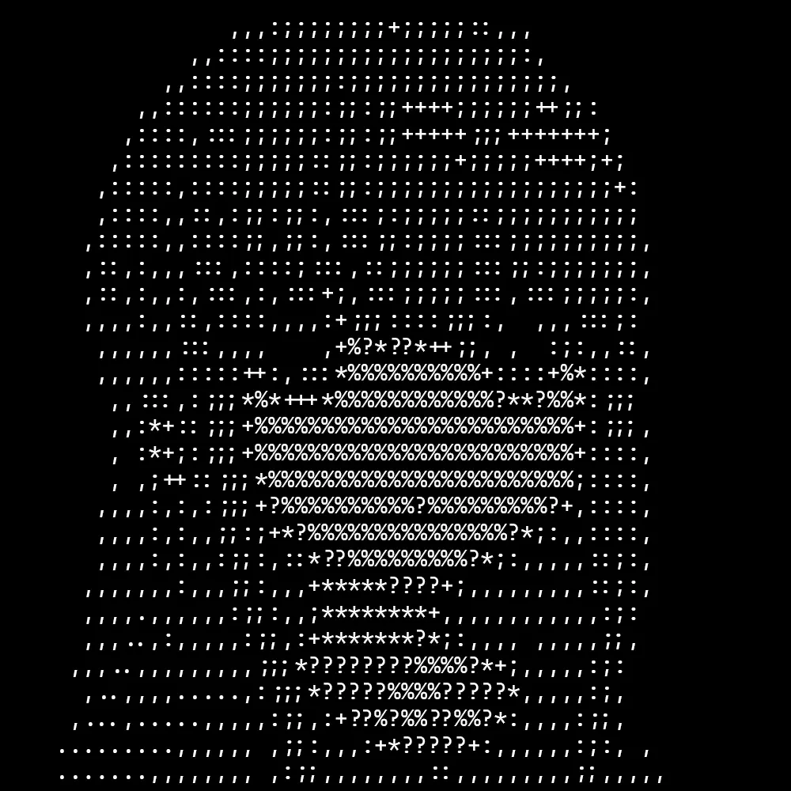
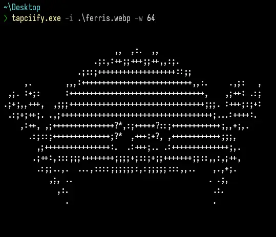
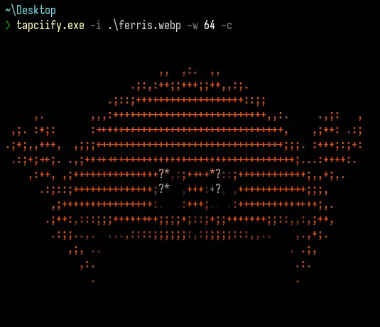
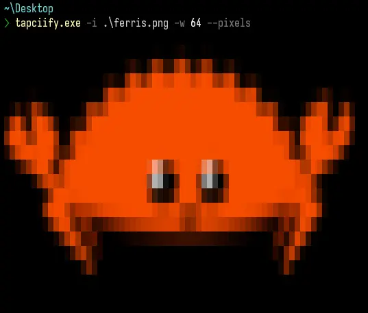
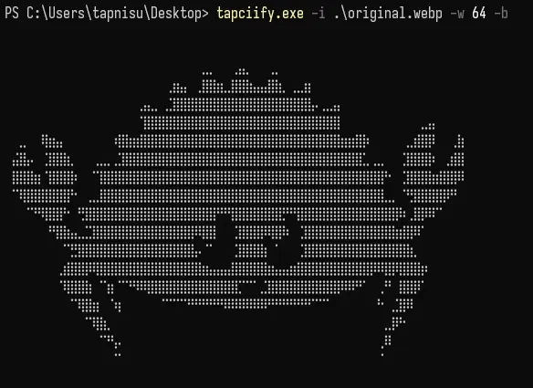
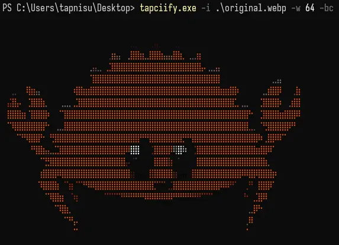
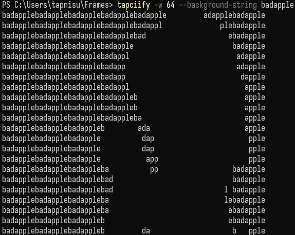

<p align="center"></p>
<h1 align="center">Tapciify</h1>
<p align="center">CLI tool for converting your images into ASCII art</p>

## Requirements

1. CC linker (Windows - Microsoft Visual Studio with C++ Support) (Linux - gcc)

2. [Rust](https://www.rust-lang.org/tools/install)
   > **Important**:
   > Current minimal Rust version is 1.87!

## Installation

Using cargo:

```bash
cargo install tapciify
```

Using cargo-binstall:

```bash
cargo binstall tapciify -y
```

## Converting image

1. Run: `tapciify -i imagePath -w imageWidth` for image.

2. Run: `tapciify -i imagePath -w imageWidth -r` for reversed colors.

## Converting video

In this example I set framerate to 24 (but you can use any another)

> Requires ffmpeg

1. Make frames from video into dir:

   ```bash
   mkdir frames; ffmpeg -i bad_apple.mkv frames/%08d.jpeg
   ```

2. Run:

   ```bash
   tapciify -i frames/* -w videoWidth -f 24
   ```

## Examples

| Type   | Image     | Command
| ----------|-----------|------------
| Original  |  | `Original Image` 
| ASCII  |  | `tapciify -i ./assets/examples/ferris.webp -w 64` 
| ASCII colored  |  | `tapciify -i ./assets/examples/ferris.webp -w 64 -c` 
| Pixels   | | `tapciify -i ./assets/examples/ferris.webp -w 64 --pixels` 
| Braille  |  | `tapciify -i ./assets/examples/ferris.webp -w 64 -b` 
| Braille colored  |  | `tapciify -i ./assets/examples/ferris.webp -w 64 -bc` 
| Background string |  | `tapciify -i ./assets/examples/bad-apple.webp -w 64 --background-string badapple` 
